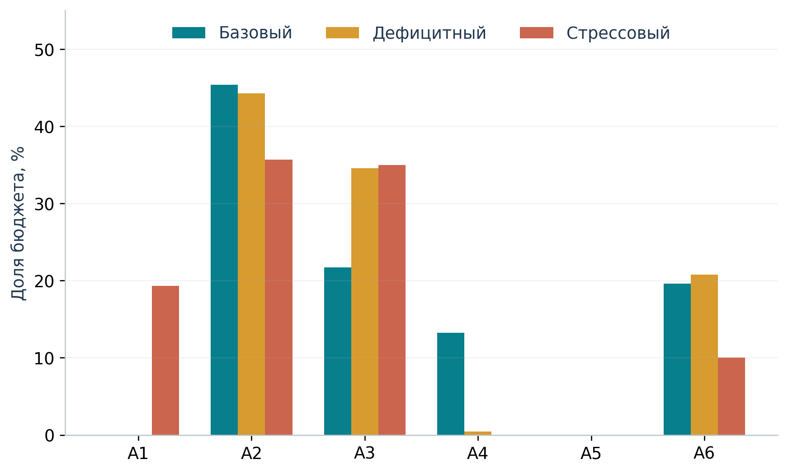
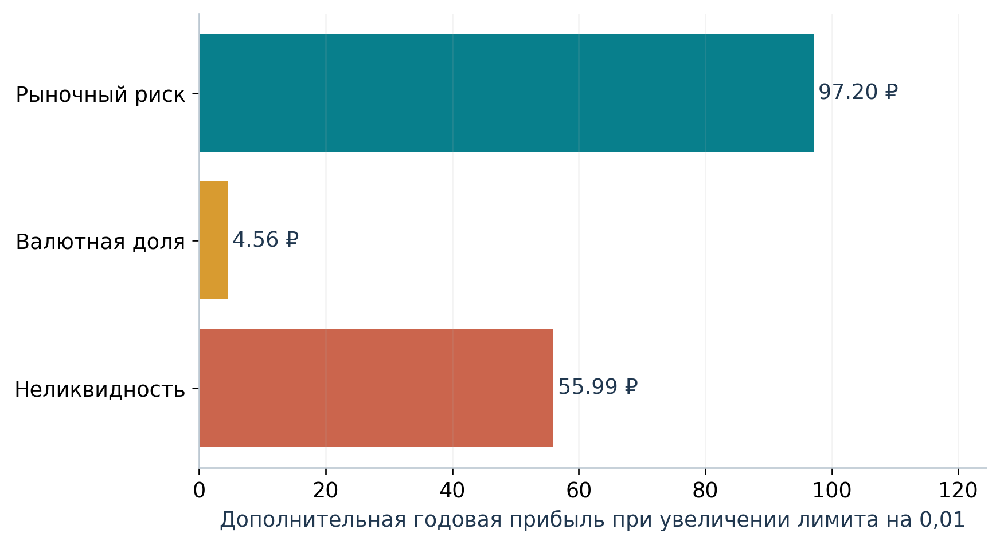
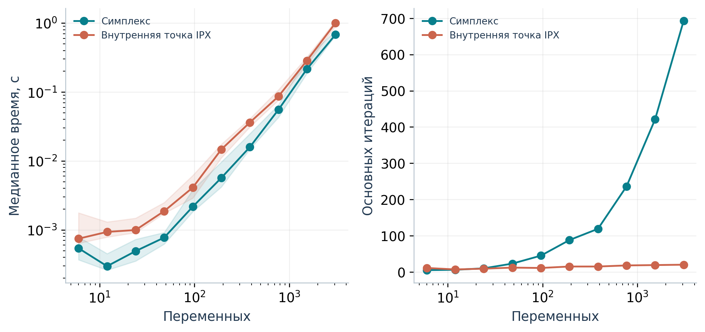

# Лабораторная работа № 1: ЛП-модель распределения ресурсов (Портфель ценных бумаг)

**Дисциплина:** Методы оптимизации. Линейное программирование  
**Вариант:** 5 (Группа 527, номер в списке $N = 12$, год $Y = 26$)  
**Параметры генерации:** $\text{seed} = 10000 + 100 \cdot 2 + 12 = 10212$  
**Инструментарий:** Python 3.13, решатель HiGHS (`highspy`), SciPy, NumPy, Matplotlib  

---

## 1. Постановка задачи и допущения

### 1.1. Ситуация и цель работы
Требуется распределить инвестиционный бюджет $B = 100\,000\text{ руб.}$ между шестью условными классами активов на горизонт 1 год так, чтобы **максимизировать ожидаемую годовую доходность** портфеля при соблюдении трёх линейных ограничений риска.

### 1.2. Принятые учебные допущения
* **Делимость вложений:** разрешено покупать произвольные дробные доли активов ($x_i \ge 0$), минимальные биржевые лоты не учитываются.
* **Полное инвестирование:** весь бюджет распределяется без остатка ($\sum x_i = 1$). Короткие позиции, кредитное плечо, комиссии брокера и налоги не моделируются.
* **Линейная аппроксимация риска:** вместо квадратичной ковариационной матрицы (модели Марковица) используются три линейных показателя риска (рыночный балл, валютная экспозиция, неликвидность). Это позволяет оставаться в рамках классической задачи линейного программирования (ЛП).
* **Синтетические данные:** значения доходностей и коэффициентов риска сгенерированы программно при фиксированном `seed = 10212` и сохранены в файле `data/lab1.json`.

---

## 2. Исходные данные варианта

| Код | Условный класс актива | Годовая доходность $r_i$ | Рыночный риск $m_i$ (балл $0\dots 1$) | Валютная доля $v_i$ ($0$ или $1$) | Неликвидность $l_i$ (доля $0\dots 1$) |
| :--- | :--- | :---: | :---: | :---: | :---: |
| **A1** | Защитные облигации | $6.1\%$ ($0.061$) | $0.082$ | $0$ | $0.000$ |
| **A2** | Корпоративные облигации | $8.6\%$ ($0.086$) | $0.248$ | $0$ | $0.158$ |
| **A3** | Валютные облигации | $8.0\%$ ($0.080$) | $0.197$ | $1$ | $0.058$ |
| **A4** | Зарубежные акции | $14.8\%$ ($0.148$) | $0.858$ | $1$ | $0.125$ |
| **A5** | Акции внутреннего рынка | $13.3\%$ ($0.133$) | $0.728$ | $0$ | $0.254$ |
| **A6** | Малоликвидные бумаги | $16.9\%$ ($0.169$) | $0.667$ | $0$ | $0.913$ |

### Лимиты рисков портфеля (базовый сценарий)

| Ограничение | Предельное значение ($b_j$) | Содержательный смысл |
| :--- | :---: | :--- |
| **Рыночный риск** | $\le 0.400$ | Средневзвешенный балл рыночного риска всего портфеля |
| **Валютная доля** | $\le 0.350$ | Не более $35\%$ бюджета в активах, зависящих от валютного курса |
| **Неликвидность** | $\le 0.280$ | Средневзвешенная доля труднореализуемых бумаг не выше $28\%$ |

---

## 3. Формальная математическая модель

* **Множества:** $I = \{1, 2, 3, 4, 5, 6\}$ — множество доступных активов.
* **Переменные решения:** $x_i \ge 0$ ($i \in I$) — доля общего бюджета, вкладываемая в $i$-й актив (безразмерная величина, $x_i \in [0, 1]$).
* **Целевая функция** — максимизация ожидаемой годовой доходности портфеля (в долях единицы):
  $$F(x) = \sum_{i=1}^{6} r_i x_i = 0.061x_1 + 0.086x_2 + 0.080x_3 + 0.148x_4 + 0.133x_5 + 0.169x_6 \to \max$$
  *(Ожидаемая прибыль в рублях вычисляется как $\text{Profit} = 100\,000 \cdot F(x)$).*

* **Система ограничений:**
  1. **Баланс бюджета (нормировка долей):**
     $$\sum_{i=1}^{6} x_i = x_1 + x_2 + x_3 + x_4 + x_5 + x_6 = 1$$
  2. **Ограничение рыночного риска (безразм.):**
     $$0.082x_1 + 0.248x_2 + 0.197x_3 + 0.858x_4 + 0.728x_5 + 0.667x_6 \le 0.400$$
  3. **Ограничение валютной экспозиции (безразм.):**
     $$x_3 + x_4 \le 0.350$$
  4. **Ограничение неликвидности (безразм.):**
     $$0.158x_2 + 0.058x_3 + 0.125x_4 + 0.254x_5 + 0.913x_6 \le 0.280$$
  5. **Неотрицательность долей:**
     $$x_i \ge 0, \quad \forall i \in \{1, \dots, 6\}$$

---

## 4. Реализация и решение базового сценария

### 4.1. Параметры решателя
* **Интерфейс:** `highspy` (прямой вызов C++ ядра HiGHS через разреженную матрицу `scipy.sparse.csr_matrix`). Так как `common.solve()` выполняет минимизацию, решателю передаётся вектор $-r$.
* **Алгоритм:** прямой/двойственный симплекс-метод (`method='simplex'`), предобработка `presolve='on'`, число потоков `threads=1`.
* **Допуски солвера:** прямой и двойственный допуски допустимости $10^{-9}$.
* **Статус решения:** `optimal` (доказанный глобальный оптимум задачи).

### 4.2. Оптимальный базовый портфель
* **Ожидаемая годовая доходность:** $10.919993\%$ ($0.109199926855$)
* **Ожидаемая годовая прибыль:** $10\,919.99\text{ руб.}$

| Актив | Название | Оптимальная доля $x_i^*$ | Сумма вложений, руб. | Ожидаемый доход, руб. |
| :---: | :--- | :---: | :---: | :---: |
| **A1** | Защитные облигации | $0.0000\%$ | $0.00$ | $0.00$ |
| **A2** | Корпоративные облигации | $45.3820\%$ | $45\,382.04$ | $3\,902.86$ |
| **A3** | Валютные облигации | $21.7397\%$ | $21\,739.67$ | $1\,739.17$ |
| **A4** | Зарубежные акции | $13.2603\%$ | $13\,260.33$ | $1\,962.53$ |
| **A5** | Акции внутреннего рынка | $0.0000\%$ | $0.00$ | $0.00$ |
| **A6** | Малоликвидные бумаги | $19.6180\%$ | $19\,617.96$ | $3\,315.43$ |
| **Итого** | **Весь портфель** | **$100.0000\%$** | **$100\,000.00$** | **$10\,919.99$** |

### 4.3. Почему активы A1 и A5 не вошли в портфель?
В линейном программировании оптимум достигается в угловой точке (вершине) многогранника допустимых решений, где часть переменных обращается в ноль:
* **Актив A5** имеет высокую доходность ($13.3\%$), но одновременно потребляет много лимита рыночного риска ($0.728$) и неликвидности ($0.254$). Комбинация **A4** (высокий доход $14.8\%$, но низкая неликвидность $0.125$) и **A6** (максимальный доход $16.9\%$) эффективнее утилизирует выделенные квоты риска.
* **Актив A1** обладает минимальным риском ($0.082$), но его доходность ($6.1\%$) слишком мала: в базовом режиме выгоднее использовать более доходные облигации **A2** ($8.6\%$) и **A3** ($8.0\%$).

---

## 5. Независимая проверка решения

Для исключения ошибок при формировании матрицы ограничений реализована независимая функция `check()` на чистом `NumPy` (без обращения к объектам солвера HiGHS), пересчитывающая все ограничения напрямую по словарю из `data/lab1.json` с допуском $\varepsilon = 10^{-7}$:

| Проверяемое условие | Вычисленное значение | Лимит / Требование | Запас (Slack) | Статус |
| :--- | :---: | :---: | :---: | :---: |
| Сумма долей ($\sum x_i$) | $1.0000000000000000$ | $= 1.000$ | $0.000000$ | Выполняется |
| Рыночный риск ($\sum m_i x_i$) | $0.4000000000000000$ | $\le 0.400$ | $0.000000$ | Активно |
| Валютная доля ($\sum v_i x_i$) | $0.3500000000000000$ | $\le 0.350$ | $0.000000$ | Активно |
| Неликвидность ($\sum l_i x_i$) | $0.2800000000000000$ | $\le 0.280$ | $0.000000$ | Активно |
| Неотрицательность ($\min x_i$) | $0.0000000000000000$ | $\ge 0.000$ | — | Выполняется |

* **Максимальное численное нарушение:** $2.22 \times 10^{-16} \le 10^{-7}$ (машинная точность `float64`).
* **Дополнительная сверка:** задача решена альтернативным интерфейсом `scipy.optimize.linprog(..., method='highs')`; расхождение целевой функции составило $0.00\text{ (в пределах } 10^{-16}\text{)}$.
* **Тестирование на испорченных данных (`verify_lab1.py`):** функция `check()` успешно отклонила искусственно нарушенный бюджет, завышенную целевую функцию и вложение $100\%$ в высокорисковый актив A4.

---

## 6. Сценарный анализ и анализ чувствительности

### 6.1. Сравнение трёх сценариев
1. **Базовый:** исходные лимиты ($0.400 / 0.350 / 0.280$).
2. **Дефицитный:** лимит рыночного риска снижен на $20\%$ (с $0.400$ до $0.320$).
3. **Стрессовый:** одновременное ужесточение двух условий на $40\%$ — рыночный риск снижен до $0.240$, неликвидность до $0.168$.

| Сценарий | Статус | Доходность | Прибыль, руб. | Изменение к базе | Доли активов $(A_1; A_2; A_3; A_4; A_5; A_6)$, % |
| :--- | :---: | :---: | :---: | :---: | :--- |
| **Базовый** | `optimal` | $10.9200\%$ | $10\,919.99$ | — | $(0.0;\; 45.4;\; 21.7;\; 13.3;\; 0.0;\; 19.6)$ |
| **Дефицитный** | `optimal` | $10.1424\%$ | $10\,142.40$ | $-777.59\text{ руб.}$ | $(0.0;\; 44.3;\; 34.6;\; 0.4;\; 0.0;\; 20.8)$ |
| **Стрессовый** | `optimal` | $8.7373\%$ | $8\,737.35$ | $-2\,182.64\text{ руб.}$ | $(19.4;\; 35.7;\; 35.0;\; 0.0;\; 0.0;\; 9.9)$ |

**Интерпретация перестройки портфеля:**
* В **дефицитном** сценарии из-за нехватки рыночного лимита модель почти полностью избавляется от рисковых зарубежных акций **A4** ($13.3\% \to 0.4\%$) и перекладывает средства в более спокойные валютные облигации **A3** ($21.7\% \to 34.6\%$).
* В **стрессовом** сценарии **A4** исчезает полностью ($0\%$), доля малоликвидного **A6** падает вдвое ($19.6\% \to 9.9\%$), а для удержания низкого рыночного риска в портфель впервые включаются защитные облигации **A1** ($19.4\%$). Все три сценария остаются допустимыми (`optimal`), так как в модели присутствуют низкорисковые защитные инструменты.

### 6.2. Теневые цены и диапазоны устойчивости базиса
Все три ограничения риска в базовом плане являются **активными** (запас равен нулю). Их теневые цены $y_j$ показывают, на сколько вырастет доходность портфеля при ослаблении соответствующего лимита на $1$ единицу (в пределах сохранения текущего оптимального базиса):

| Ограничение | Базовый лимит | Теневая цена $y_j$ | Прирост прибыли при $+0.01$ к лимиту | Нижняя граница базиса | Верхняя граница базиса |
| :--- | :---: | :---: | :---: | :---: | :---: |
| **Рыночный риск** | $0.400$ | $0.09719904$ | **$+97.20\text{ руб.}$** | $0.317280$ | $0.535616$ |
| **Неликвидность** | $0.280$ | $0.05599152$ | **$+55.99\text{ руб.}$** | $0.140216$ | $0.429054$ |
| **Валютная доля** | $0.350$ | $0.00455630$ | **$+4.56\text{ руб.}$** | $0.134159$ | $0.750516$ |

* **Что выгоднее нарастить в первую очередь:** при одинаковом шаге ослабления ($+0.01$) наибольший прирост доходности даёт ослабление **лимита рыночного риска** ($+97.20\text{ руб.}$ в год).
* **Сверка прогноза теневой цены со сценариями:**
  * В *дефицитном* сценарии рыночный лимит снижен до $0.320$. Это значение попадает внутрь интервала устойчивости $[0.317280;\; 0.535616]$, поэтому базис не меняется (те же 4 актива $A_2, A_3, A_4, A_6$), и линейный прогноз по теневой цене ($10\,919.99 - 0.08 \cdot 9719.90 = 10\,142.40\text{ руб.}$) **абсолютно точно** совпадает с фактическим результатом.
  * В *стрессовом* сценарии лимит $0.240$ выходит за нижнюю границу устойчивости ($0.317280$), происходит смена базиса (выбывает $A_4$, входит $A_1$), и локальная теневая цена перестаёт давать точный прогноз — требуется перерешивание модели.

---

## 7. Задания «со звёздочкой» (на оценку «Отлично»)

### 7.1. Задание со звёздочкой № 1: Полная двойственная модель и сертификат оптимальности

Для прямой задачи $\max r^T x$ при $Ax \le b$, $\mathbf{1}^T x = 1$, $x \ge 0$ выпишем полную двойственную задачу, вводя неотрицательные двойственные переменные $y_1, y_2, y_3 \ge 0$ для трёх неравенств риска и свободную по знаку переменную $z \in \mathbb{R}$ для бюджетного равенства:

$$\min_{y, z} \; b^T y + z = 0.400 y_1 + 0.350 y_2 + 0.280 y_3 + z$$
$$\text{при ограничениях: } A^T y + z \cdot \mathbf{1} \ge r, \quad y_1, y_2, y_3 \ge 0, \quad z \in \mathbb{R}$$

Двойственная задача решена как самостоятельная ЛП (`logs/dual.log`):
* Получены оценки: $y_1 = 0.0971990437$, $y_2 = 0.0045563036$, $y_3 = 0.0559915241$, $z = 0.0530479764$.
* Значение двойственной целевой функции: $0.109199926855$.
* **Двойственный разрыв:** $|b^T y + z - r^T x| = 1.39 \times 10^{-17} \approx 0$. По теореме сильной двойственности это является строгим математическим доказательством глобальной оптимальности найденного портфеля.
* **Проверка условий дополняющей нежёсткости** $x_i \cdot ((A^T y + z \cdot \mathbf{1})_i - r_i) = 0$:

| Актив | Доля в прямой задаче $x_i^*$ | Двойственный запас $(A^T y + z)_i - r_i$ | Согласованность |
| :---: | :---: | :---: | :--- |
| **A1** | $0.0000\%$ | $+0.0000182979$ | Запас $> 0 \implies$ актив не покупается ($x_1 = 0$) |
| **A2** | $45.3820\%$ | $0.0000000000$ | Актив в базисе $\implies$ равенство в двойственном ограничении |
| **A3** | $21.7397\%$ | $0.0000000000$ | Актив в базисе $\implies$ равенство в двойственном ограничении |
| **A4** | $13.2603\%$ | $0.0000000000$ | Актив в базисе $\implies$ равенство в двойственном ограничении |
| **A5** | $0.0000\%$ | $+0.0050307273$ | Запас $> 0 \implies$ актив не покупается ($x_5 = 0$) |
| **A6** | $19.6180\%$ | $0.0000000000$ | Актив в базисе $\implies$ равенство в двойственном ограничении |

---

### 7.2. Задание со звёздочкой № 2: Бенчмарк Симплекс-метода против метода внутренней точки (IPX)

Сгенерирована серия из $10$ задач портфельной оптимизации растущей размерности (от $n=6, m=3$ до $n=3072, m=180$, `seeds = 11212..11221`). Каждая задача решалась обоими методами (`simplex` и `ipx`) по $5$ раз (всего $100$ запусков, `presolve='on'`, `threads=1`, `crossover='on'`). Все $100$ решений прошли независимую проверку на `NumPy` с допуском $10^{-7}$, значения целевых функций обоих методов совпали.

| Задача | Переменных $n$ | Ограничений $m$ | Медиана Simplex, мс | Медиана IPX, мс | Итераций Simplex | Итераций IPX |
| :---: | :---: | :---: | :---: | :---: | :---: | :---: |
| 1 | $6$ | $3$ | $0.549$ | $1.244$ | $5$ | $11$ |
| 2 | $12$ | $5$ | $0.491$ | $1.042$ | $6$ | $7$ |
| 3 | $24$ | $8$ | $0.556$ | $1.613$ | $10$ | $9$ |
| 4 | $48$ | $12$ | $0.760$ | $2.056$ | $23$ | $12$ |
| 5 | $96$ | $20$ | $1.313$ | $2.819$ | $45$ | $11$ |
| 6 | $192$ | $30$ | $3.792$ | $6.513$ | $88$ | $15$ |
| 7 | $384$ | $50$ | $9.345$ | $29.527$ | $119$ | $15$ |
| 8 | $768$ | $80$ | $57.050$ | $91.713$ | $236$ | $18$ |
| 9 | $1536$ | $120$ | $182.249$ | $278.143$ | $421$ | $19$ |
| 10 | $3072$ | $180$ | $714.301$ | $953.774$ | $693$ | $20$ |

**Вывод по эксперименту:**
Число итераций метода внутренней точки IPX практически не зависит от размерности задачи ($7 \to 20$ итераций), тогда как у симплекс-метода оно растёт линейно/суперлинейно ($5 \to 693$ итераций). Однако каждая итерация IPX требует решения плотной системы линейных уравнений (факторизации Холецкого) плюс шаг `crossover` для приведения решения к базисной вершине. Поэтому на плотных портфельных матрицах данного масштаба симплекс-метод стабильно выигрывает по астрономическому времени ($0.71\text{ с}$ против $0.95\text{ с}$ на максимальной задаче).

---

## 8. Выводы и практическая применимость

1. **Математический итог:** построена, решена и независимо верифицирована непрерывная ЛП-модель формирования инвестиционного портфеля. Найдено единственное невырожденное вершинное оптимальное решение с ожидаемой доходностью $10.92\%$ годовых.
2. **Можно ли реализовать решение на практике и что этому мешает?**
   В чистом виде найденный вектор долей нельзя напрямую исполнить на реальной бирже по следующим причинам:
   * **Лотность и дискретность:** акции и облигации торгуются целыми лотами, поэтому вложение $13\,260.33\text{ руб.}$ в актив A4 потребует округления до ближайшего целого числа бумаг (переход к MILP-постановке).
   * **Транзакционные издержки:** модель не учитывает брокерские и биржевые комиссии, а также спред между ценой покупки и продажи (особенно критичный для малоликвидного актива A6).
   * **Нелинейность риска и корреляции:** в реальном управлении активами риск измеряется волатильностью (дисперсией) портфеля с учётом взаимной корреляции бумаг, что требует квадратичного программирования (QP), а не линейной взвешенной суммы.
   * **Неопределённость доходности:** параметры $r_i$ являются прогнозными оценками, а не гарантированной доходностью будущего периода.

---

## Приложение. Шпаргалка по вопросам к защите (в контексте ЛР № 1)

1. **Переменные, параметры, цель, ограничения и единицы:** переменные $x_i$ — доли бюджета (безразм.); параметры $r_i, m_i, v_i, l_i$ — доходность и риски (безразм.), $B = 100\,000\text{ руб.}$; цель — максимизация годовой доходности; ограничения — нормировка суммы долей ($=1$) и 3 лимита риска.
2. **Линейность и допущения:** все выражения имеют вид $\sum a_i x_i$. Упрощения: отказ от квадратичной ковариации (дисперсии), делимость бумаг (нет лотов), отсутствие комиссий и налогов.
3. **Независимая проверка:** функция `check()` на чистом `NumPy` читает исходный `lab1.json` и проверяет выполнение равенств и неравенств с допуском $10^{-7}$, не обращаясь к матрицам построителя и объекту HiGHS. Дополнительно проведена сверка с `scipy.optimize.linprog` и двойственной моделью.
4. **Статусы солвера:** `optimal` — найден оптимум; `infeasible` — противоречивые ограничения (в ЛР 1 не возникло благодаря наличию защитного актива A1, но при возникновении нужно ослаблять лимиты или искать конфликтный набор строк); `unbounded` — цель уходит в бесконечность (возникло бы, если забыть ограничение $\sum x_i = 1$).
5. **Активные ограничения:** в оптимуме активны все 3 риска ($0.400, 0.350, 0.280$), бюджетное равенство ($1.0$) и нижние границы $x_1 = 0, x_5 = 0$.
6. **Теневая цена и интервал устойчивости:** производная цели по правой части ограничения ($\Delta F \approx y_j \Delta b_j$). Для рыночного риска $y_1 = 0.0972$ ($+97.20\text{ руб.}$ за $+0.01$ к лимиту), действует в диапазоне $[0.3173;\; 0.5356]$ при неизменных остальных лимитах.
7. **Двойственная задача:** $\min b^T y + z$ при $A^T y + z \mathbf{1} \ge r, y \ge 0$. Переменные $y_j$ — предельные оценки лимитов риска, $z$ — множитель бюджетной нормировки. Сильная двойственность подтверждена ($1.39 \times 10^{-17}$).
8. **Вершинный оптимум:** в задаче $6$ переменных, и в оптимуме пересекаются $6$ линейно независимых активных ограничений ($1$ бюджет $+ 3$ риска $+ 2$ нулевые переменные $x_1, x_5$), что однозначно задаёт вершину 6-мерного многогранника.
9. **Вырожденность и альтернативные оптимумы:** базис из 4 положительных долей имеет полный ранг $4$ (невырожден), а двойственные запасы у небазисных $A_1, A_5$ строго положительны ($>0$), что гарантирует единственность оптимального портфеля.
10. **Воспроизводимость (`seed` и `requirements.txt`):** без `seed = 10212` сгенерируются другие доходности и риски; без фиксации версий библиотек и решателя HiGHS могут измениться порядок обхода базисов, число итераций и время работы.
11. **Математическая гарантия vs эксперимент:** глобальная оптимальность портфеля в рамках модели и равенство двойственных оценок гарантированы математически; время работы в бенчмарке (Simplex vs IPX) и применимость к реальному рынку — экспериментальные/модельные оценки.