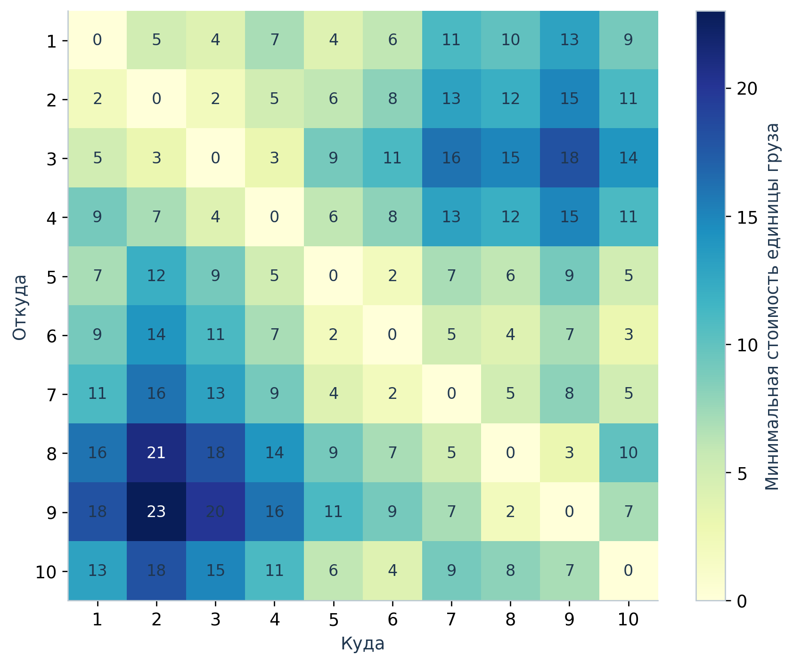
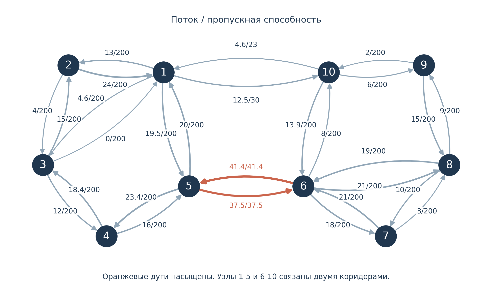
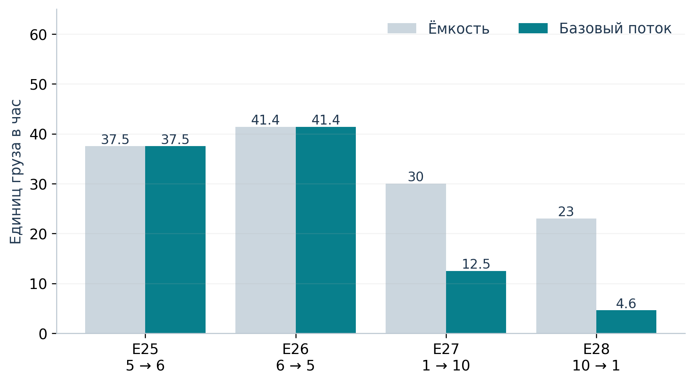

# Лабораторная работа № 2. Транспортные и сетевые модели

**Дисциплина:** Методы оптимизации. Линейное программирование  
**Выполнила:** Кузьмина Валерия Б24-527  
**Индивидуальный вариант:** `V = 5` (`seed = 10212`)  
**Стек реализации:** Python 3.13, HiGHS (`highspy`), NumPy, SciPy, Matplotlib, NetworkX

---

## 1. Постановка задачи и учебные допущения

### 1.1 Цель и смысл варианта 5

Согласно индивидуальному варианту 5, требуется построить и решить сетевую модель для направленного графа из **10 вершин**: найти кратчайшие пути между всеми упорядоченными парами вершин и определить узкие места сети. При этом общие требования лабораторной работы предусматривают задание пропускных способностей дуг, распределение одновременного спроса, проверку балансов, анализ сценариев (рост спроса и отказ дуги) и сравнение с жадной эвристикой.

Чтобы выполнить обе части, работа разделена на два связанных этапа, оба из которых решаются как задачи непрерывного линейного программирования (LP) в промышленном решателе HiGHS:

1. **Этап A (поиск всех кратчайших путей):** для каждой из $10 \times 9 = 90$ упорядоченных пар различных узлов $(s, t)$ найти минимальную стоимость единичного потока без совместных ограничений пропускной способности. *(Классический алгоритм Флойда–Уоршелла используется исключительно как независимый инструмент перекрёстной проверки расстояний, а не как основной решатель).*
2. **Этап B (многопродуктовый поток минимальной стоимости):** задать одновременный часовой спрос $d_k$ между всеми 90 парами и найти оптимальное распределение потоков по дугам с учётом их общих пропускных способностей $u_e$.

### 1.2 Учебные допущения

* **Линейность затрат:** стоимость перевозки единицы груза $c_e$ по каждой дуге постоянна и не зависит от степени её загрузки.
* **Делимость и стационарность:** потоки $f_e^k \ge 0$ непрерывны и измеряются в единицах груза в час. Модель описывает усреднённый стационарный режим и допускает расщепление груза одной пары по нескольким параллельным маршрутам.
* **Отсутствие нелинейных эффектов:** не моделируются заторы и рост времени доставки при приближении к пределу ёмкости, очереди в узлах, временные окна и неделимость транспортных средств (рейсов).

---

## 2. Топология сети и исходные данные

Исходные данные сгенерированы с зафиксированным `seed = 10212` и сохранены в файле `data/lab2.json`. Внутри программного кода узлы индексируются с нуля (`0..9`), а на схемах и в таблицах отчёта — с единицы (`1..10`).

Сеть содержит **10 вершин** и **28 направленных дуг**:

* **Группа 1 (узлы 1–5)** и **Группа 2 (узлы 6–10)** представляют собой две локальные подсети. В каждой группе построено двустороннее кольцо и по одному двустороннему сокращающему соединению (хорды `1 ↔ 3` и `6 ↔ 8`). Все 24 внутренние дуги имеют высокую пропускную способность $u_e = 200$ ед./ч и случайную целочисленную стоимость $c_e \in [2; 8]$ у.е./ед.
* Между группами проложены **два двусторонних межгрупповых коридора** — дешёвый узкий (между узлами 5 и 6) и дорогой резервный (между узлами 1 и 10):

| Код дуги | Направление | Стоимость $c_e$, у.е./ед. | Пропускная способность $u_e$, ед./ч | Роль в структуре сети |
| :---: | :---: | :---: | :---: | :--- |
| **E25** | $5 \rightarrow 6$ | 2 | 37,5 | Дешёвый узкий коридор (из группы 1 в 2) |
| **E26** | $6 \rightarrow 5$ | 2 | 41,4 | Дешёвый узкий коридор (из группы 2 в 1) |
| **E27** | $1 \rightarrow 10$ | 20 | 30,0 | Дорогой резервный обход (из группы 1 в 2) |
| **E28** | $10 \rightarrow 1$ | 20 | 23,0 | Дорогой резервный обход (из группы 2 в 1) |

Для каждой из $90$ упорядоченных пар $k = (s_k, t_k)$ сгенерирован часовой спрос $d_k \in \{1, 2, 3\}$ ед./ч.

---

## 3. Формальная математическая модель

### Множества и параметры

* $V = \{1, \dots, 10\}$ — множество вершин (узлов) сети;
* $E = \{1, \dots, 28\}$ — множество направленных дуг;
* $K = \{1, \dots, 90\}$ — множество упорядоченных пар источник–получатель $k = (s_k, t_k)$, где $s_k \ne t_k$;
* $\delta^+(v)$ и $\delta^-(v)$ — множества дуг, выходящих из вершины $v$ и входящих в неё соответственно;
* $c_e > 0$ — стоимость перевозки единицы груза по дуге $e \in E$ (у.е./ед.);
* $u_e > 0$ — пропускная способность дуги $e \in E$ (ед./ч);
* $d_k > 0$ — объём груза, который необходимо перевезти для пары $k \in K$ (ед./ч).

### Переменные решения

* $f_e^k \ge 0$ — интенсивность потока груза пары $k \in K$ по дуге $e \in E$ (ед./ч). Всего в модели $90 \times 28 = 2520$ непрерывных переменных.

### Постановка Этапа A (кратчайшие пути как блочная LP)

Для поиска минимальных расстояний без ограничения ёмкости из каждого источника $s_k$ в получатель $t_k$ отправляется ровно $1$ условная единица потока:

$$\min \sum_{k \in K} \sum_{e \in E} c_e f_e^k$$

при ограничениях сохранения потока для каждой пары $k \in K$ и каждой вершины $v \in V$ ($90 \times 10 = 900$ строк):

$$\sum_{e \in \delta^+(v)} f_e^k - \sum_{e \in \delta^-(v)} f_e^k = \begin{cases} 1, & v = s_k, \\ -1, & v = t_k, \\ 0, & v \notin \{s_k, t_k\}, \end{cases} \qquad f_e^k \ge 0$$

### Постановка Этапа B (многопродуктовый поток минимальной стоимости)

Минимизируются суммарные часовые затраты по всем парам и дугам:

$$\min F(f) = \sum_{k \in K} \sum_{e \in E} c_e f_e^k \quad [\text{у.е./ч}]$$

при следующих ограничениях:

1. **Баланс потока в каждой вершине** ($\forall k \in K, \forall v \in V$):
   $$\sum_{e \in \delta^+(v)} f_e^k - \sum_{e \in \delta^-(v)} f_e^k = \begin{cases} d_k, & v = s_k, \\ -d_k, & v = t_k, \\ 0, & v \notin \{s_k, t_k\}. \end{cases}$$

2. **Совместная пропускная способность дуг** ($\forall e \in E$):
   $$\sum_{k \in K} f_e^k \le u_e$$

3. **Неотрицательность потоков:** $f_e^k \ge 0$ ($\forall k \in K, \forall e \in E$).

---

## 4. Реализация и результаты базового расчёта

### 4.1 Параметры решателя

Матрица ограничений формируется в разреженном формате `scipy.sparse.csr_matrix` ($900$ строк баланса + $28$ строк пропускной способности = $928$ строк, $2520$ столбцов) и передаётся в решатель HiGHS через интерфейс `highspy`. Использован симплекс-метод (`simplex`), включена предобработка (`presolve = on`), число потоков `threads = 1`, прямой и двойственный допуски допустимости $10^{-9}$.

### 4.2 Результаты Этапа A: матрица минимальных расстояний

Статус решения — `optimal`. Для каждой из 90 пар из оптимального базисного потока восстановлен кратчайший маршрут (таблица `results/lab2/shortest_paths.csv`). Сравнение всех 90 значений с независимым алгоритмом Флойда–Уоршелла показало точное совпадение: максимальное расхождение составило **`0.00e+00`**.

### 4.3 Результаты Этапа B: базовое распределение потоков

* **Статус решения:** `optimal`.
* **Минимальная суммарная стоимость:** **`1 831,40` у.е./ч**.
* **Структура потоков:** дешёвые межгрупповые дуги **E25** ($5 \rightarrow 6$) и **E26** ($6 \rightarrow 5$) полностью исчерпали свою пропускную способность (`37,5 / 37,5` ед./ч и `41,4 / 41,4` ед./ч). Оставшийся межгрупповой трафик направлен через дорогой резервный коридор **E27** ($1 \rightarrow 10$: `12,5 / 30,0` ед./ч) и **E28** ($10 \rightarrow 1$: `4,6 / 23,0` ед./ч). Все 24 внутренние дуги имеют значительный запас пропускной способности (загрузка не превышает `24 / 200` ед./ч).

### 4.4 Независимая проверка на NumPy

Функция `lab2.check()` без обращения к объекту HiGHS и матрицам построителя проверила решение по исходному `data/lab2.json` отдельно для каждой из 90 пар в каждом из 10 узлов, просуммировала потоки по дугам и пересчитала целевую функцию:

| Проверяемый критерий | Полученное значение | Допустимый порог | Результат |
| :--- | :---: | :---: | :---: |
| Максимальное нарушение баланса в узлах (по всем 90 парам) | `0.00e+00` | $\le 10^{-7}$ | Пройдено |
| Максимальное превышение пропускной способности дуг | `0.00e+00` | $\le 10^{-7}$ | Пройдено |
| Независимо пересчитанная целевая функция | `1 831,40` у.е./ч | Расхождение $\le 10^{-7}$ | Пройдено |

---

## 5. Анализ узких мест, сценарии и сравнение с эвристикой

### 5.1 Узкие места сети и теневые цены ёмкости

Активными ограничениями пропускной способности в оптимуме являются только две дуги — **E25** и **E26**. Их теневые цены (в минимизационной постановке отрицательны; в таблице приведена экономия затрат при увеличении пропускной способности на $+1$ ед./ч) подтверждены прямым перерасчётом при приращении $\Delta u_e = +0,01$ ед./ч:

| Узкое место | Направление | Ёмкость, ед./ч | Базовый поток, ед./ч | Экономия от $+1$ ед./ч ёмкости | Проверка при $\Delta u = +0,01$ (прогноз / факт) |
| :---: | :---: | :---: | :---: | :---: | :---: |
| **E25** | $5 \rightarrow 6$ | 37,5 | 37,5 | **18,00 у.е./ч** | `0,1800` / `0,1800` у.е./ч |
| **E26** | $6 \rightarrow 5$ | 41,4 | 41,4 | **9,00 у.е./ч** | `0,0900` / `0,0900` у.е./ч |

### 5.2 Сценарный анализ

| Сценарий | Изменение условий | Статус солвера | Суммарные затраты, у.е./ч | Предметная интерпретация |
| :--- | :--- | :---: | :---: | :--- |
| **Базовый** | Исходные данные (`seed = 10212`) | `optimal` | `1 831,40` | Оптимальный баланс между дешёвым и резервным коридорами. |
| **Рост спроса на 20%** | Все $d_k$ умножены на $1,2$ | `optimal` | `2 407,20` | Затраты выросли на **+31,44%** (непропорционально росту спроса), так как дешёвые дуги E25 и E26 уже насыщены, и весь дополнительный трафик пошёл по дорогому обходу ($c_e = 20$). |
| **Отказ самой загруженной дуги (E26)** | Ёмкость дуги E26 ($6 \rightarrow 5$, поток `41,4` ед./ч) установлена в `0` | `infeasible` | — | **Несовместимость (сертификат разреза):** суммарный спрос из группы $\{6..10\}$ в $\{1..5\}$ составляет `46,0` ед./ч, а единственная оставшаяся выходная дуга E28 ($10 \rightarrow 1$) имеет ёмкость `23,0` ед./ч. Дефицит $\ge 23,0$ ед./ч. |

*Примечание по сценарию отказа дуги:* несмотря на то, что граф остался топологически связным (путь через дугу E28 существует), его пропускной способности недостаточно для обслуживания всего спроса. Финансовый ущерб в этом режиме нельзя выразить разностью стоимостей; для денежной оценки в модель необходимо было бы ввести фиктивные дуги недопоставки со штрафами.

### 5.3 Сравнение с жадной эвристикой

Простая жадная эвристика упорядочивает пары по убыванию спроса $d_k$ и последовательно направляет каждую пару по текущему кратчайшему пути с ненулевой остаточной ёмкостью:

| Метод решения | Статус / Допустимость | Суммарная стоимость, у.е./ч | Время расчёта, мс | Зазор к оптимуму |
| :--- | :---: | :---: | :---: | :---: |
| **ЛП-оптимум (HiGHS)** | `optimal` (допустим) | `1 831,40` | `14,549` | `0,00%` |
| **Жадная эвристика** | Допустим (весь спрос обслужен) | `1 966,10` | `0,784` | **`+7,36%`** |

Жадная стратегия проигрывает оптимуму **`7,36%`** (`+134,70` у.е./ч), поскольку пары с большим объёмом первыми занимают дешёвый коридор без учёта того, насколько дорогой обход придётся использовать другим парам.

---

## 6. Выводы и практическая применимость

1. **Выводы по результатам работы:** Сетевая модель успешно реализована в двух постановках (кратчайшие пути и многопродуктовый поток). Выявлены критические узкие места сети (дуги E25 и E26), доказано непропорциональное удорожание логистики при росте спроса на 20% и построен независимый сертификат несовместимости при отказе наиболее загруженного канала.
2. **Можно ли реализовать найденное решение на практике и какие ограничения модели этому мешают:** В текущем виде решение пригодно только как стратегическая оценка пропускной способности и тарифов. Реальной реализации мешают следующие упрощения модели:
   * **Делимость потоков:** на практике грузы перевозятся неделимыми транспортными единицами (фурами, вагонами, контейнерами), что требует целочисленных переменных (MILP);
   * **Постоянство стоимости и отсутствие задержек:** в реальных транспортных и телекоммуникационных сетях при загрузке канала свыше 80–90% возникают очереди, заторы и нелинейный рост времени доставки;
   * **Стационарность:** модель не учитывает суточные колебания спроса, временные окна доставки и расписания отправлений.

---

## 7. Краткие ответы на контрольные вопросы к защите (по теме ЛР № 2)

1. **Что является переменными, параметрами, целью и ограничениями модели?**  
   *Переменные:* потоки $f_e^k \ge 0$ (ед./ч). *Параметры:* стоимости $c_e$ (у.е./ед.), ёмкости $u_e$ (ед./ч) и спрос $d_k$ (ед./ч). *Цель:* минимизация общих затрат $\sum_{k,e} c_e f_e^k$ (у.е./ч). *Ограничения:* сохранение потока в узлах для каждой пары и общая пропускная способность каждой дуги $\sum_k f_e^k \le u_e$.
2. **Зачем проверять баланс отдельно для каждой пары $k$, а не суммарный баланс в узле?**  
   При проверке только общего баланса ошибка одного груза могла бы случайно скомпенсироваться противоположной ошибкой другого (например, один груз исчез в узле, а другой там же возник).
3. **Почему при отказе дуги E26 получился статус `infeasible`, если путь между группами остался?**  
   Топологическая связность графа не гарантирует достаточной пропускной способности. Через разрез между узлами $\{6..10\}$ и $\{1..5\}$ требуется передать `46,0` ед./ч, а единственная оставшаяся дуга E28 вмещает лишь `23,0` ед./ч.
4. **Каков экономический смысл двойственных переменных в этой модели?**  
   Двойственные переменные балансовых уравнений ($\pi_v^k$) — это узловые потенциалы, а двойственные оценки ограничений пропускной способности ($\lambda_e \ge 0$) — теневые цены дуг, показывающие предельную экономию затрат при расширении узкого места на 1 ед./ч.