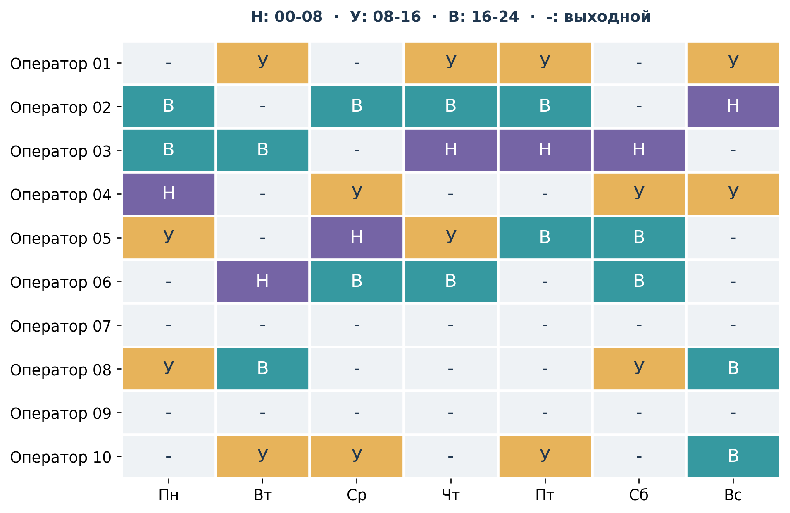
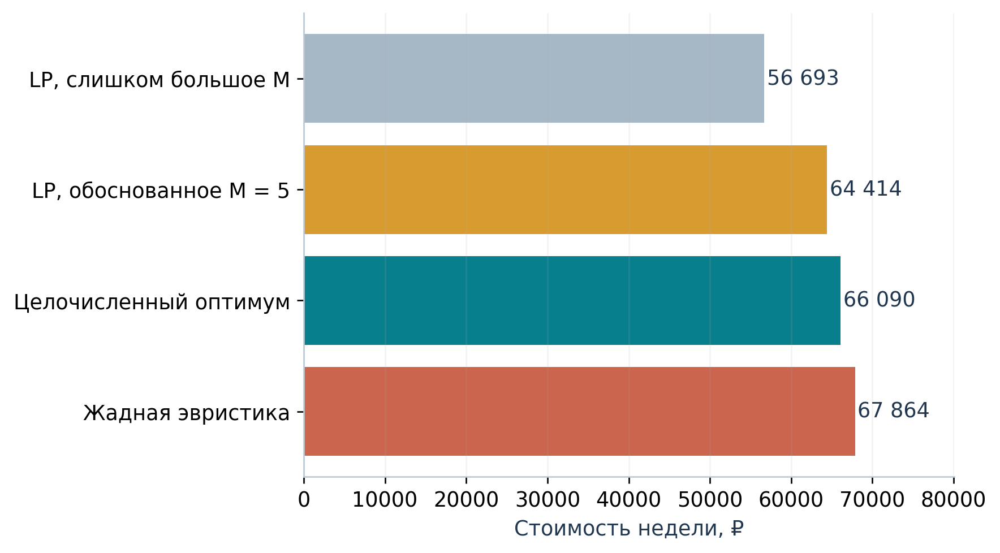
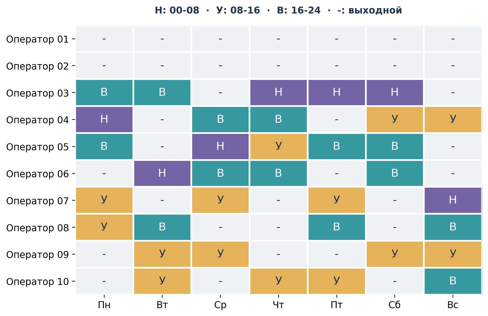
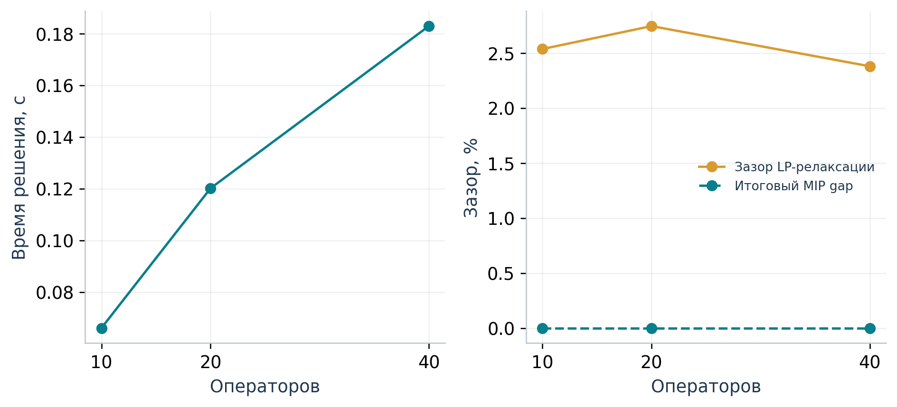

# Лабораторная работа № 3. MILP-модель дискретного выбора (Расписание смен)

**Дисциплина:** Методы оптимизации. Линейное программирование  
**Выполнила:** Кузьмина Валерия Б24-527
**Индивидуальный вариант:** `V = 5` (`seed = 10212`)  
**Стек реализации:** Python 3.13, HiGHS (`highspy`), NumPy, SciPy, Matplotlib

---

## 1. Постановка задачи и учебные допущения

### 1.1 Цель и смысл варианта 5
Согласно индивидуальному варианту 5, требуется построить и решить модель смешанно-целочисленного линейного программирования (MILP) для составления оптимального недельного расписания работы колл-центра для **10 операторов** на **7 дней** по **3 восьмичасовые смены** в сутки.

| Смена | Часы работы | Индекс $s$ | Базовая потребность в день ($q_{d,s}$), чел. |
| :---: | :---: | :---: | :---: |
| **Н (ночная)** | `00:00–08:00` | `0` | 1 |
| **У (утренняя)** | `08:00–16:00` | `1` | 2 |
| **В (вечерняя)** | `16:00–24:00` | `2` | 2 |

Суммарная потребность составляет $1 + 2 + 2 = 5$ назначений в день, или $7 \times 5 = 35$ рабочих выходов за неделю. Задача относится к классу дискретного выбора: назначение сотрудника на смену и его подключение к работе на неделе являются неделимыми бинарными решениями («да/нет»).

### 1.2 Учебные правила и допущения
* **Лимиты нагрузки:** каждый оператор может отработать не более **1 смены в сутки** и не более **5 смен (40 часов) за неделю**.
* **Доступность:** назначение возможно только в те дни и смены, когда сотрудник доступен (задаётся бинарной матрицей $a_{i,d,s} \in \{0, 1\}$).
* **Междусменный отдых:** между сменами соседних рабочих дней требуется не менее **16 часов отдыха**. На выбранной сетке трёх 8-часовых смен это запрещает переход к смене с меньшим индексом на следующий день (после вечерней смены `В` нельзя ставить ночную `Н` или утреннюю `У`, после утренней `У` нельзя ставить ночную `Н`).
* **Структура затрат:** за подключение оператора к работе на неделе выплачивается фиксированная плата $F_i$; каждый выход оплачивается по стоимости $c_{i,d,s}$; первые 32 часа (4 смены) считаются обычной нагрузкой, а часы сверх 32 (5-я смена, до максимума 40 часов) дополнительно премируются по ставке $p_i$ за час.
* **Упрощения модели:** не учитываются переход графика через границу недели (между воскресеньем и следующим понедельником), квалификация операторов по типам звонков, перерывы внутри смены и стохастическая очередь обращений. Правила являются учебной постановкой, а не полным отражением ТК РФ.

---

## 2. Исходные данные

Исходные таблицы сгенерированы с зафиксированным `seed = 10212` и сохранены в файле `data/lab3.json`. Генератор задаёт условную часовую ставку каждого оператора от `150` до `230` руб./ч, фиксированную недельную плату от `700` до `1600` руб., коэффициенты смен `1,25` (Н), `1,00` (У), `1,10` (В), индивидуальную стоимость предпочтений `0..150` руб. и доступность с вероятностью `92%`. Надбавка за сверхурочный час равна половине часовой ставки ($p_i = 0,5 w_i$).

| Оператор | Фиксированная плата $F_i$, ₽/нед. | Надбавка за сверхурочные $p_i$, ₽/ч |
| :---: | :---: | :---: |
| **01** | 1 178 | 97,0 |
| **02** | 738 | 81,5 |
| **03** | 1 228 | 80,5 |
| **04** | 1 296 | 88,0 |
| **05** | 962 | 88,0 |
| **06** | 762 | 92,5 |
| **07** | 1 588 | 108,5 |
| **08** | 1 451 | 96,5 |
| **09** | 1 027 | 114,0 |
| **10** | 937 | 93,0 |

---

## 3. Формальная математическая MILP-модель

### Множества и параметры
* $I = \{1, \dots, 10\}$ — множество операторов;
* $D = \{1, \dots, 7\}$ — множество дней недели;
* $S = \{0, 1, 2\}$ — множество смен (`Н`, `У`, `В`);
* $a_{i,d,s} \in \{0, 1\}$ — параметр доступности оператора $i$ в день $d$ на смену $s$;
* $q_{d,s} \in \mathbb{Z}_+$ — требуемое количество операторов в день $d$ на смену $s$ (чел.);
* $c_{i,d,s} > 0$ — стоимость выхода оператора $i$ в день $d$ на смену $s$ (руб.);
* $F_i > 0$ — фиксированные затраты на подключение оператора $i$ к неделе (руб.);
* $p_i > 0$ — дополнительная надбавка за сверхурочный час оператора $i$ (руб./ч).

### Переменные решения
* $x_{i,d,s} \in \{0, 1\}$ — бинарная переменная: назначен ли оператор $i$ в день $d$ на смену $s$ (**210 бинарных переменных**);
* $y_i \in \{0, 1\}$ — бинарная переменная: подключён ли оператор $i$ к работе на этой неделе (**10 бинарных переменных**);
* $o_i \in [0, 8]$ — непрерывная переменная: количество оплачиваемых сверхурочных часов оператора $i$ за неделю (**10 непрерывных переменных**).

Всего в модели **230 переменных**, из них **220 бинарных**. *(В оптимальном целочисленном решении $o_i$ автоматически принимает значения $0$ или $8$ часов, так как каждая смена длится 8 часов, поэтому требовать целочисленности $o_i$ отдельно не нужно).*

### Целевая функция
Минимизация суммарных недельных расходов колл-центра (руб./нед.):
$$\min C = \sum_{i \in I} \sum_{d \in D} \sum_{s \in S} c_{i,d,s} x_{i,d,s} + \sum_{i \in I} F_i y_i + \sum_{i \in I} p_i o_i$$

### Система ограничений
1. **Покрытие потребности в сменах** ($\forall d \in D, \forall s \in S$):
   $$\sum_{i \in I} x_{i,d,s} \ge q_{d,s}$$
2. **Учёт индивидуальной доступности** ($\forall i \in I, \forall d \in D, \forall s \in S$):
   $$0 \le x_{i,d,s} \le a_{i,d,s}, \qquad x_{i,d,s} \in \{0, 1\}$$
3. **Не более одной смены в день на человека** ($\forall i \in I, \forall d \in D$):
   $$\sum_{s \in S} x_{i,d,s} \le 1$$
4. **Недельный предел выходов** ($\forall i \in I$):
   $$L_i = \sum_{d \in D} \sum_{s \in S} x_{i,d,s} \le 5$$
5. **Логическая связка с подключением сотрудника (`big-M`)** ($\forall i \in I$, обоснованная константа $M = 5$):
   $$L_i \le M y_i, \qquad y_i \in \{0, 1\}, \qquad M = 5$$
6. **Подсчёт сверхурочных часов сверх 32 часов** ($\forall i \in I$):
   $$o_i \ge 8 L_i - 32, \qquad 0 \le o_i \le 8$$
7. **Междусменный отдых не менее 16 часов между соседними днями** ($\forall i \in I, \forall d \in \{1..6\}, \forall s \in S, \forall t < s$):
   $$x_{i,d,s} + x_{i,d+1,t} \le 1$$

---

## 4. Реализация, базовое расписание и независимая проверка

### 4.1 Параметры решателя HiGHS
Модель собрана в разреженной матрице `scipy.sparse.csr_matrix` и решена с помощью MILP-солвера HiGHS (`highspy`) методом ветвей и отсечений при включённой предобработке (`presolve = on`), в один поток (`threads = 1`), с допуском целочисленной допустимости $10^{-8}$, относительным разрывом `mip_rel_gap = 1e-8` и лимитом времени `60` с.

### 4.2 Результаты базового сценария
* **Статус решения:** `optimal` (итоговый `MIP gap = 0,000%`, доказанный глобальный оптимум).
* **Минимальная недельная стоимость:** **`66 090` ₽**:
  * Оплата сменных выходов: `55 538` ₽;
  * Фиксированные недельные расходы (за 8 подключённых операторов): `8 552` ₽;
  * Доплата за сверхурочные (операторы `02`, `03` и `05` отработали по 5 смен): `2 000` ₽.
* Все 35 обязательных смен покрыты точно; операторы `07` и `09` в работу не включались ($y_7 = y_9 = 0$) из-за более высоких часовых ставок и фиксированной платы.

### 4.3 LP-релаксация и интегральный зазор
При снятии требования целочисленности ($0 \le x_{i,d,s} \le 1$, $0 \le y_i \le 1$) задача превращается в непрерывную LP-релаксацию:
* **Оптимальная стоимость LP-релаксации:** `64 414` ₽;
* **Целочисленный MILP-оптимум:** `66 090` ₽;
* **Интегральный зазор (Integrality Gap):** $\frac{66\,090 - 64\,414}{66\,090} \times 100\% = \mathbf{2,5359\%}$.

**Где «ломается» непрерывное решение:** в LP-релаксации `14` назначений $x_{i,d,s}$ и все `10` переменных подключения $y_i$ приняли дробные значения. Например, при $L_i = 4$ сменах связка $4 \le 5 y_i$ позволяет выбрать $y_i = 0,8$ и оплатить лишь 80% фиксированной платы подключения. Выдать такой дробный план сотрудникам нельзя, а независимое округление дробей нарушит покрытие смен и правило 16-часового отдыха.

### 4.4 Независимая проверка на NumPy
Функция `lab3.check()` без обращения к объекту HiGHS и матрицам построителя проверила по исходному `data/lab3.json` все ограничения: покрытие каждой из 21 смен недели, доступность, дневную и недельную нагрузку, запрещённые переходы между сменами, связку $L_i \le 5 y_i$, сверхурочные, целочисленность переменных $x$ и $y$ с допуском $10^{-7}$, а также заново пересчитала целевую функцию (`66 090` ₽). Все проверки пройдены успешно; дополнительно проверено отклонение намеренно испорченных планов (дробных значений, нулевой активации при наличии смен, неполного покрытия).

---

## 5. Эксперименты: выбор `big-M`, сценарии, эвристика и масштабирование

### 5.1 Влияние константы `big-M` на силу релаксации
Мы сравнили обоснованную константу $M = 5$ (выведенную из недельного лимита $L_i \le 5$) с неоправданно завышенным значением $M = 10\,000$:
* Множество допустимых *целых* расписаний и итоговый целый оптимум (`66 090` ₽) не изменились благодаря наличию отдельного ограничения $L_i \le 5$.
* Однако **нижняя граница LP-релаксации упала с `64 414` ₽ до `56 692,90` ₽**, а зазор к целому оптимуму вырос с `2,5359%` до **`14,2186%`**, поскольку при $L_i = 5$ релаксация может взять $y_i = 5/10000 = 0,0005$ и практически обнулить фиксированные выплаты $F_i$. Слишком маленькое $M$ (например, $M = 4$), напротив, ошибочно запретило бы 5-ю смену.

### 5.2 Сценарный анализ (Базовый / Дефицитный / Стрессовый)

| Сценарий | Модификация условий | Статус солвера | Недельная стоимость, ₽ | Содержательный анализ перестройки |
| :--- | :--- | :---: | :---: | :--- |
| **Базовый** | 10 операторов, спрос `1 / 2 / 2` в день | `optimal` | `66 090` | Работают 8 операторов; дорогие операторы `07` и `09` находятся в резерве. |
| **Дефицитный** | Операторы `01` и `02` недоступны всю неделю (-20% персонала) | `optimal` | `69 985` | Стоимость выросла на **`+3 895` ₽**. Для закрытия всех 35 смен в график включены ранее неиспользованные операторы `07` и `09`. |
| **Стрессовый** | Нет операторов `01` и `02` + ночной спрос вырос с 1 до 2 (`2 / 2 / 2`) | `infeasible` | — | **Независимый сертификат несовместимости:** требуется $7 \times (2 + 2 + 2) = 42$ выхода, тогда как 8 доступных операторов физически могут дать максимум $8 \times 5 = 40$ смен ($42 > 40$). |

### 5.3 Сравнение с жадной эвристикой
Многократный жадный алгоритм (`30` запусков: первый — по возрастанию числа доступных кандидатов на смену, остальные `29` — со случайным перемешиванием порядка заполнения) выбирает на каждый выход допустимого сотрудника с минимальной добавочной стоимостью (учитывая ставку смены, новое подключение и прирост сверхурочных):

| Метод решения | Статус / Допустимость | Стоимость недели, ₽ | Время расчёта, мс | Зазор к оптимуму |
| :--- | :---: | :---: | :---: | :---: |
| **Точный MILP (HiGHS)** | `optimal` (`MIP gap = 0%`) | `66 090` | `42,677` | `0,0000%` |
| **Жадная эвристика (30 попыток)** | Допустим (все правила соблюдены) | `67 864` | `12,167` | **`+2,6842%`** |

Жадная стратегия проигрывает точному решению **`2,6842%`** (`+1 774` ₽ переплаты в неделю), так как локально выгодные ранние назначения не учитывают будущую нехватку доступных операторов на поздние смены.

### 5.4 Масштабирование задачи (10, 20 и 40 операторов)
Проведена серия экспериментов при пропорциональном росте штата ($n \in \{10, 20, 40\}$, seeds `10212`, `10232`, `10252`) и суточной потребности:

| Операторов ($n$) | Бинарных переменных ($22n$) | Непрерывных переменных ($n$) | Время решения, с | Зазор LP-релаксации, % | Итоговый MIP gap, % | Узлов дерева |
| :---: | :---: | :---: | :---: | :---: | :---: | :---: |
| **10** | 220 | 10 | `0,0427` | `2,5359%` | `0,000%` | 1 |
| **20** | 440 | 20 | `0,1385` | `2,7444%` | `0,000%` | 1 |
| **40** | 880 | 40 | `0,1911` | `2,3796%` | `0,000%` | 1 |

На всех трёх масштабах солвер доказал глобальную оптимальность (`MIP gap = 0%`) в корневом узле дерева благодаря эффективной предобработке и отсечениям HiGHS.

---

## 6. Выводы и практическая применимость

1. **Выводы по результатам работы:** Построена и решена MILP-модель составления недельного расписания колл-центра. Продемонстрирована вычислительная цена дискретности (`2,54%`), показано критическое влияние точной константы `big-M` ($M = 5$) на силу непрерывной релаксации и получен арифметический сертификат несовместимости в стрессовом сценарии ($42 > 40$).
2. **Можно ли реализовать найденное решение на практике и какие ограничения модели этому мешают:** Найденное расписание полностью допустимо в рамках учебных правил, но для внедрения в реальном колл-центре модель требует следующих расширений:
   * **Справедливость распределения нагрузки:** текущая целевая функция загружает дешёвых сотрудников на 5 смен со сверхурочными, оставляя дорогих без работы; на практике необходимо добавить ограничения на минимальное число смен или выравнивание часов;
   * **Стыковка смежных недель:** запрет на переход с вечерней смены воскресенья на ночную смену понедельника в однонедельном горизонте не контролируется;
   * **Квалификация и внутрисменная динамика:** реальные операторы имеют разные навыки (линии поддержки), а поток звонков меняется по часам, что требует гибких смен и учёта обеденных перерывов.

---